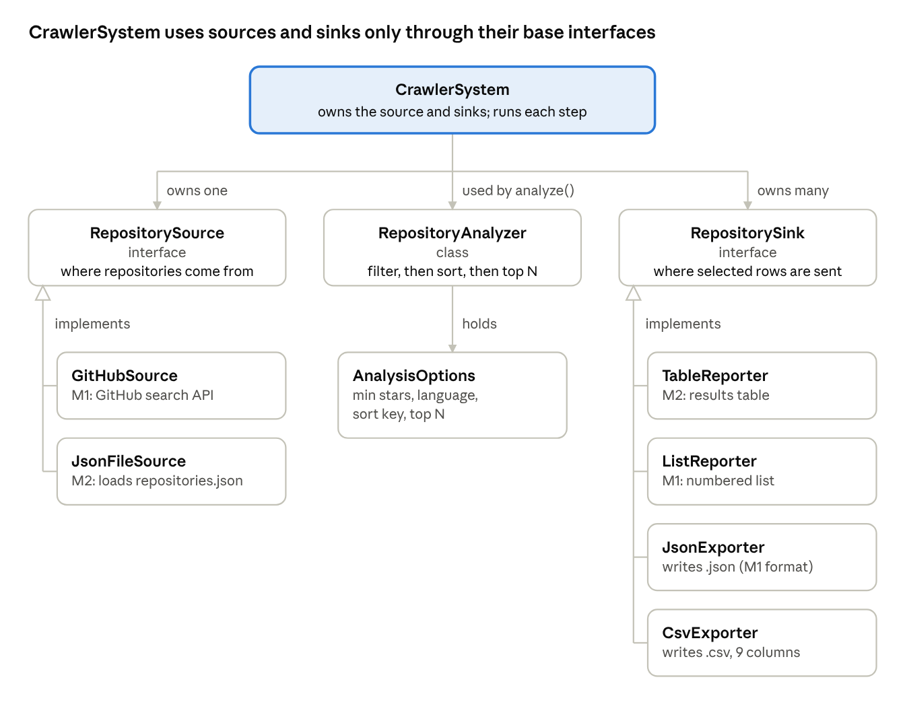

# GitHub Project Crawler — System Design

CS 3460 Modern C++ · Zack Kingston · Nov 10, 2026

## Overview

The GitHub Project Crawler collects repository metadata from the GitHub search API, saves it as a local JSON dataset, and analyzes that dataset offline. A run either crawls (query GitHub, save `repositories.json`) or analyzes (load the file, filter, sort, keep the top N, print and export the result).

Milestones 1 and 2 already work as free functions grouped by file. This design organizes them into a small set of classes with one responsibility each. Data sources, analysis and output can then be explained, replaced and tested separately. It is a design proposal: the class refactor, the tests and their measured results will be added in the final milestone.

## 1. Requirements

The system collects one dataset, then answers analysis requests over it without the network. Each requirement states observable behavior that a test can check.

| ID | Requirement |
| --- | --- |
| R1 | Query the GitHub search API for 1 to 100 repositories matching a search string, sending `GITHUB_TOKEN` when it is set. |
| R2 | Save the collected repositories to `repositories.json` as a JSON array with nine fields per repository: owner, name, description, stars, forks, language, size, updated_at, url. |
| R3 | Load `repositories.json` back into `std::vector<Repository>`, report how many were loaded, and reject a missing file or a non-array document. |
| R4 | Keep only repositories with at least a minimum number of stars and, when one is given, a matching language. |
| R5 | Sort by stars, forks, or update time, descending, breaking ties by owner then name; then keep the first N, or all of them if fewer than N remain. |
| R6 | Print the selected repositories as a table and export exactly the same rows to JSON or CSV, chosen by the output file's extension. |

The example below shows one analysis request and its output, taken from the saved 100-repository dataset.

| Example request | Expected output |
| --- | --- |
| `./github_crawler analyze --min-stars 100000 --sort stars --top 3` | `Repositories loaded: 100`, then three rows: codecrafters-io/build-your-own-x (550858 stars), sindresorhus/awesome (512840), public-apis/public-apis (484749); `Selected repositories: 3`; `Exported to: selected.json` |

## 2. System Design

The system has four main abstractions: RepositorySource, RepositoryAnalyzer, RepositorySink, and CrawlerSystem. RepositorySource hides where repositories come from, either GitHub or a saved file. RepositoryAnalyzer turns a full list into the selected rows. RepositorySink hides where results go: the terminal, a JSON file or a CSV file. CrawlerSystem connects them into one run.

Today `main.cpp` calls the HTTP client, parser, loader, analyzer and printers directly, and picks JSON or CSV with a string check. Behind these four abstractions, each piece can be swapped or tested without touching the others. The `Repository` struct from Milestone 1 stays the only representation of a repository.

### 2.1 Class Structure and Relationships



*Figure 1. Proposed classes and their relationships (simplified).*

The system uses inheritance for interchangeable parts. GitHubSource and JsonFileSource implement RepositorySource. TableReporter, ListReporter, JsonExporter and CsvExporter implement RepositorySink. CrawlerSystem holds one source and a list of sinks and uses them only through the base interfaces. Neither the analysis code nor the export code knows whether the data came from the network or from disk.

### 2.2 Responsibilities and Main Interfaces

RepositorySource defines how a run gets its data. GitHubSource wraps the existing `GitHubClient::search_repositories` and `parse_repositories`. JsonFileSource wraps `load_repositories`. Each one returns a complete list or throws, and `describe()` names the source for the run header (for example, `repositories.json`).

```cpp
class RepositorySource {
public:
    virtual std::vector<Repository> load() = 0;  // throws on failure
    virtual std::string describe() const = 0;
    virtual ~RepositorySource() = default;
};
```

RepositoryAnalyzer holds one `AnalysisOptions` value and applies Filter, then Sort, then Top N. It wraps the Milestone 2 functions `filter_repositories`, `sort_repositories` and the top-N resize. It never prints or writes files, so the rows it returns are exactly the rows every sink receives.

```cpp
class RepositoryAnalyzer {
private:
    AnalysisOptions options_;

public:
    explicit RepositoryAnalyzer(AnalysisOptions options);
    std::vector<Repository> run(const std::vector<Repository>& input) const;
    void describe(std::ostream& out) const;  // Filter / Language / Sort / Top N lines
};
```

RepositorySink defines how a run delivers its result. TableReporter prints the Milestone 2 table. ListReporter prints the Milestone 1 numbered list. JsonExporter reuses `save_repositories`, and CsvExporter reuses `save_repositories_csv`. Each sink writes the rows it is given and reports success.

```cpp
class RepositorySink {
public:
    virtual bool write(const std::vector<Repository>& rows) = 0;
    virtual ~RepositorySink() = default;
};
```

CrawlerSystem controls the order of work but contains no network, parsing, sorting or formatting code. A crawl is `GitHubSource` → ListReporter + JsonExporter(`repositories.json`). An analysis is `JsonFileSource` → RepositoryAnalyzer → TableReporter + one exporter. `main()` only reads the command line and builds the right objects.

```cpp
class CrawlerSystem {
private:
    std::unique_ptr<RepositorySource> source_;
    std::vector<std::unique_ptr<RepositorySink>> sinks_;

public:
    explicit CrawlerSystem(std::unique_ptr<RepositorySource> source);
    void addSink(std::unique_ptr<RepositorySink> sink);
    bool crawl();                                     // load -> every sink
    bool analyze(const RepositoryAnalyzer& analyzer); // load -> analyze -> every sink
};
```

### 2.3 Interaction for an Analysis Request

Consider `analyze --min-stars 100000 --top 3` with the default `selected.json` output. Every analysis follows the same five steps in order.

1. **Load.** CrawlerSystem calls `source_->load()`. JsonFileSource reads `repositories.json` and returns 100 `Repository` values. CrawlerSystem prints the source name and that count.
2. **Filter.** `RepositoryAnalyzer::run` keeps repositories with at least 100000 stars. The language is unset, so any language passes.
3. **Sort.** The analyzer sorts with `compare_by_stars`, descending, with ties broken by owner then name.
4. **Top N.** The analyzer resizes the list to 3. If fewer than 3 had matched, it would keep all of them.
5. **Report and export.** CrawlerSystem passes the same three rows to TableReporter, then to JsonExporter, and prints the selected count and output path.

A crawl runs the same steps with GitHubSource and no analyzer. Errors stop the run before any sink writes: a missing file, a non-array document, a bad sort key or a failed HTTP request. Together these interactions cover R1 to R6.

## 3. Test Design

The tests come from the requirements and the public interfaces above. Component tests check one class with fixed input. The end-to-end test checks that CrawlerSystem connects them correctly. Each test names its setup and expected result now; actual results will be recorded in the final milestone.

### 3.1 Planned Test Cases

| Test | Target / setup | Expected result |
| --- | --- | --- |
| T1 — GitHub parsing (R1) | Give `parse_repositories` a saved GitHub search response with 3 items, one with a null description and language. Separately, request a count of 0 and of 101. | 3 `Repository` values with the correct owner, stars and url; the null fields become `""`. Both counts are rejected before any request is sent. |
| T2 — Save dataset (R2) | Write 2 known repositories through JsonExporter. | The file parses as a JSON array of 2 objects, each with exactly the nine required fields. |
| T3 — Load dataset (R3) | Load the saved `repositories.json` through JsonFileSource, then load the T2 file. | 100 values, the first being codecrafters-io/build-your-own-x. The T2 file loads back equal to the 2 values written. |
| T4 — Load errors (R3) | Load a path that does not exist, then a file containing `{}`. | Both throw; the second message says the dataset must be a JSON array. No sink runs. |
| T5 — Filter (R4) | Analyze with `--min-stars 100000`, then with `--language Python`. | Every row has at least 100000 stars; every row in the second run has language `Python`. |
| T6 — Sort and ties (R5) | A 4-row dataset where b/x, a/z and a/y tie on stars, forks and update time. Sort by each key. | Each key sorts descending, and the tied rows always come out a/y, a/z, b/x. |
| T7 — Top N (R5) | Analyze with `--top 3`, then `--language Rust --top 50` (the dataset holds 6 Rust repositories). | Exactly 3 rows, then all 6 Rust rows with no error. |
| T8 — Export formats (R6) | Export 1 repository whose description contains a comma and a quote, to `.csv` and to `.json`. | The CSV has a 9-column header and the description quoted with the inner quote doubled. The JSON loads back equal. |
| T9 — End-to-end (R3–R6) | Run CrawlerSystem with an in-memory test source and a capturing test sink, plus a JsonExporter. | One load, one analysis; the captured rows and the exported file contain the same repositories in the same order. |

T1 uses a saved response, so it does not depend on the network or the GitHub rate limit. T6 builds its own small dataset because the real data has no exact ties. T9 replaces the real file and terminal with test objects, so the full sequence is checked the same way on any machine.

A failed test points to a component. If T9 shows the right rows printed but a different set exported, the fault is in how CrawlerSystem hands rows to the sinks, not in the analyzer. The final report will record each test's input, expected output and observed output.

### 3.2 Coverage and Evaluation Plan

| Requirement | Supporting tests | Evidence to record in final milestone |
| --- | --- | --- |
| R1 — Collect from GitHub | T1 | Parsed fields from the saved response; rejected counts. |
| R2 — Save dataset | T2, T3 | Field names in the written file; round-trip equality. |
| R3 — Load dataset | T3, T4, T9 | Loaded count; error messages for bad input. |
| R4 — Filter | T5 | Smallest star count and the languages present in the output. |
| R5 — Sort and top N | T6, T7 | Row order for each key and for ties; row counts. |
| R6 — Report and export | T8, T9 | Exported files compared with the printed rows. |

For each test that runs, the final report will add the actual result and a pass or fail status, and will explain any failure.

## Optional Bonus — Strategy Pattern for Sort Order

The proposed pattern is a Strategy that makes each sort order its own object. RepositoryAnalyzer then sorts through one interface instead of branching on a string.

**The problem.** Today the sort key appears in three places. `is_valid_sort_key` lists the valid names, `sort_repositories` has an if/else chain that picks a comparison function, and the usage text lists the names again. A new order, such as by size, means editing all three and keeping them in step. A typo in one place causes no compile error: the key is accepted, and then the list is silently left unsorted.

**The classes.** RepositoryOrder is the strategy interface. ByStars, ByForks and ByUpdated each implement it and wrap the existing named comparison function, so the ordering and tie-break rules stay as they are. A small `make_order(key)` function returns the matching strategy, or null for an unknown key. That function is the one place that knows the names.

```cpp
class RepositoryOrder {
public:
    virtual bool before(const Repository& a, const Repository& b) const = 0;
    virtual std::string name() const = 0;  // "stars", "forks", "updated"
    virtual ~RepositoryOrder() = default;
};

class ByStars : public RepositoryOrder {
public:
    bool before(const Repository& a, const Repository& b) const override {
        return compare_by_stars(a, b);
    }
    std::string name() const override { return "stars"; }
};

// adapts a strategy to the comparator std::sort expects, without a lambda.
struct OrderComparator {
    const RepositoryOrder& order;
    bool operator()(const Repository& a, const Repository& b) const {
        return order.before(a, b);
    }
};

std::unique_ptr<RepositoryOrder> make_order(const std::string& key);
```

**The difference from the basic design.** In the basic design, RepositoryAnalyzer holds the sort key as a string and branches on it every run. In the Strategy design, `main()` calls `make_order` once while reading the command line. An unknown key is rejected there, and the analyzer receives a `std::unique_ptr<RepositoryOrder>`. The analyzer then calls `std::sort(rows.begin(), rows.end(), OrderComparator{*order_})` and no longer knows which orders exist. Adding an order becomes one new class and one line in `make_order`, and each strategy can be unit-tested on two repositories without running the analyzer.
